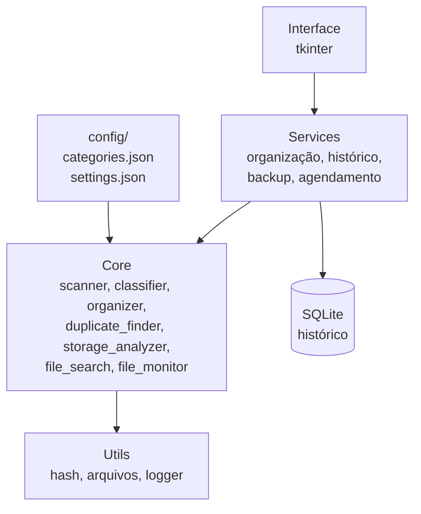

# 🗂️ FileManager

> Gerenciador inteligente de arquivos em Python: organiza pastas, encontra duplicados e analisa o uso de armazenamento, com simulação prévia e histórico para desfazer tudo.


---

## 📑 Sumário

- [Visão geral](#-visão-geral)
- [Funcionalidades](#-funcionalidades)
- [Segurança](#-segurança)
- [Arquitetura](#-arquitetura)
- [Stack](#-stack)
- [Instalação](#-instalação)
- [Roadmap](#-roadmap)
- [Aprendizados](#-aprendizados)

---

## 🎯 Visão geral

O FileManager automatiza a organização do computador: classifica arquivos por tipo e data, encontra cópias idênticas, mostra o que está ocupando espaço e monitora pastas para organizar o que chega de novo. Tudo isso com **segurança em primeiro lugar**: nada é movido ou apagado sem validação, simulação ou confirmação.

**Objetivos**

- Automatizar a organização de arquivos e diretórios
- Identificar duplicados e arquivos desnecessários
- Entender e recuperar espaço de armazenamento
- Facilitar a localização de documentos
- Evitar perda acidental de dados

---

## ⚙️ Funcionalidades

### 1. Organização inteligente

Classifica arquivos por extensão, categoria e regras personalizadas.

| Categoria | Extensões |
|---|---|
| Documentos | PDF, DOCX, TXT, ODT |
| Imagens | PNG, JPG, JPEG, SVG, WEBP |
| Vídeos | MP4, AVI, MKV, MOV |
| Áudios | MP3, WAV, FLAC, OGG |
| Planilhas | XLSX, XLS, CSV, ODS |
| Apresentações | PPTX, PPT, ODP |
| Programas | EXE, MSI, APK |
| Compactados | ZIP, RAR, 7Z, TAR |
| Códigos | PY, C, CPP, JAVA, JS, HTML, CSS |
| Outros | Não classificados |

Também organiza por data de criação ou modificação (ano e mês), cria categorias automaticamente e destaca arquivos sem categoria.

### 2. Detecção de duplicados

- Pré-filtro por tamanho e confirmação por hash **SHA-256**
- Lista de caminhos das cópias e estimativa de espaço recuperável
- Seleção manual do que remover, sempre com confirmação

### 3. Análise de armazenamento

- Pastas e arquivos mais pesados
- Espaço por categoria e arquivos antigos
- Estimativa de espaço recuperável

### 4. Busca

Filtros por nome, extensão, categoria, tamanho, datas de criação e modificação e diretório.

### 5. Monitoramento e agendamento

- Observa pastas configuradas e organiza novos arquivos automaticamente
- Tarefas agendadas: organização diária ou semanal, análise periódica e busca de duplicados

### 6. Interface gráfica

Dashboard com resumo de armazenamento, arquivos analisados e organizados, espaço por categoria e últimas operações. Seções: Organizador, Duplicados, Armazenamento, Busca, Monitoramento, Histórico e Configurações.

---

## 🔒 Segurança

1. Nenhum arquivo é movido sem uma operação previamente validada
2. **Modo de simulação (dry run)** com pré-visualização das mudanças
3. Arquivos existentes nunca são sobrescritos automaticamente; conflitos de nome são verificados
4. Diretórios críticos do sistema ficam protegidos
5. Operações destrutivas exigem confirmação
6. Histórico de movimentações permite rastrear e **desfazer** alterações
7. Erros e operações são registrados em log

---

## 🏗️ Arquitetura



```text
FileManager/
├── main.py
├── requirements.txt
├── core/          # scanner, classifier, organizer, duplicate_finder,
│                  # storage_analyzer, file_search, file_monitor
├── services/      # organization, backup, history, scheduler
├── database/      # connection, models, repositories/
├── interface/     # app, dashboard e uma view por seção
├── config/        # categories.json, settings.json
├── utils/         # file_utils, hash_utils, logger
├── logs/
└── tests/         # scanner, classifier, organizer, duplicates
```

---

## 🛠️ Stack

| Tecnologia | Uso |
|---|---|
| Python | Linguagem principal |
| `pathlib`, `os`, `shutil` | Caminhos, diretórios, mover e copiar |
| `hashlib` | Hash SHA-256 para duplicados |
| `json` | Configurações |
| `sqlite3` | Histórico e persistência |
| `logging` | Registro de operações |
| `tkinter` | Interface gráfica |
| `watchdog` | Monitoramento de pastas |
| `schedule` | Agendamento de tarefas |
| `threading` | Tarefas em segundo plano |

---

## 📦 Instalação

**Pré-requisitos:** Python 3.10+ e Git.

```bash
# 1. Clonar e entrar na pasta
git clone https://github.com/JonnyMarcus/FileManager.git
cd FileManager

# 2. Criar e ativar o ambiente virtual
python -m venv venv
venv\Scripts\activate          # Windows
# source venv/bin/activate     # Linux/macOS

# 3. Instalar dependências
pip install -r requirements.txt

# 4. Executar
python main.py
```

---

## 🗺️ Roadmap

- [ ] **V1.0 — Organizador básico:** scanner, classificação por extensão, categorias automáticas, movimentação, dry run, proteção contra sobrescrita
- [ ] **V2.0 — Gerenciamento avançado:** duplicados com SHA-256, análise de armazenamento, arquivos grandes, organização por data, busca avançada
- [ ] **V3.0 — Segurança e automação:** histórico, desfazer, backup, monitoramento, organização automática, agendamento
- [ ] **V4.0 — Interface gráfica:** dashboard, painéis de organização e duplicados, análise visual, histórico, configurações
- [ ] **V5.0 — Acabamento:** testes completos, otimização, UX, documentação técnica, empacotamento para Windows

---

## 📚 Aprendizados

Programação orientada a objetos, manipulação de arquivos e diretórios, estruturas de dados, arquitetura modular, SQLite, tratamento de exceções, concorrência, automação de tarefas, testes automatizados e interfaces gráficas.

---

## 📌 Status

🚧 Em desenvolvimento, de forma incremental, priorizando segurança, modularidade e facilidade de manutenção.

Projeto pessoal para aprofundamento em Python, automação e engenharia de software.
